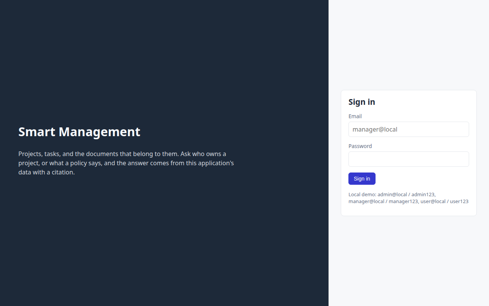
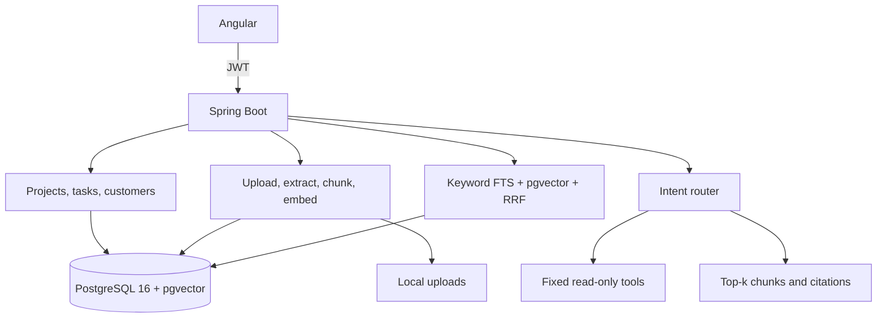
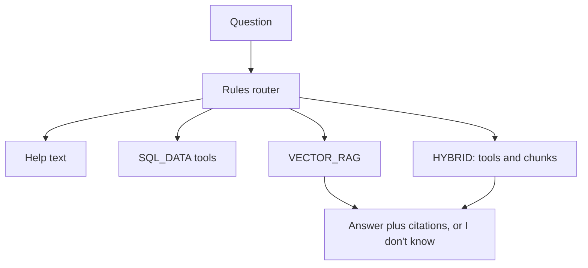
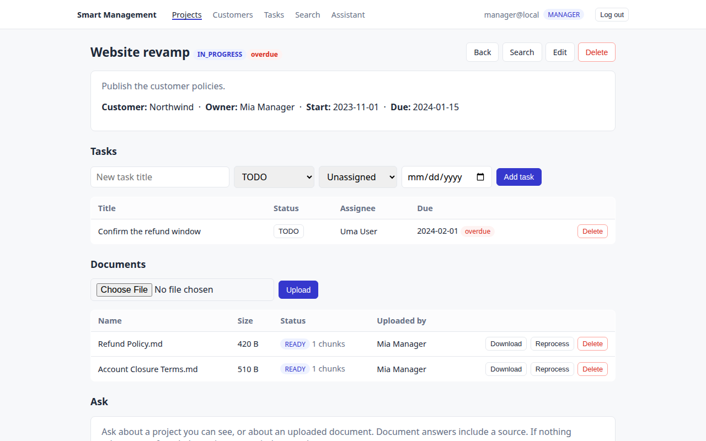
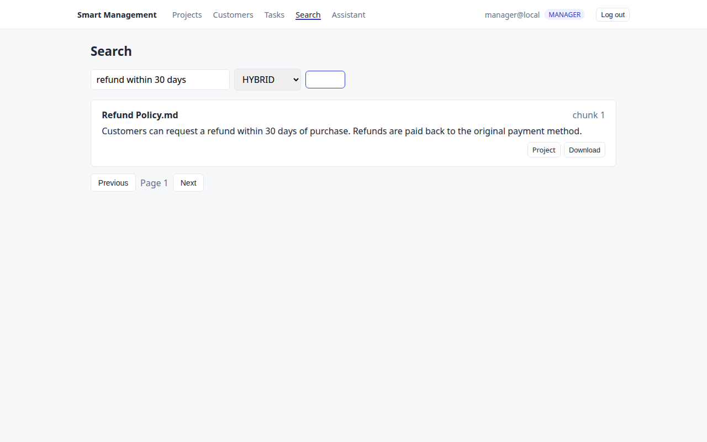
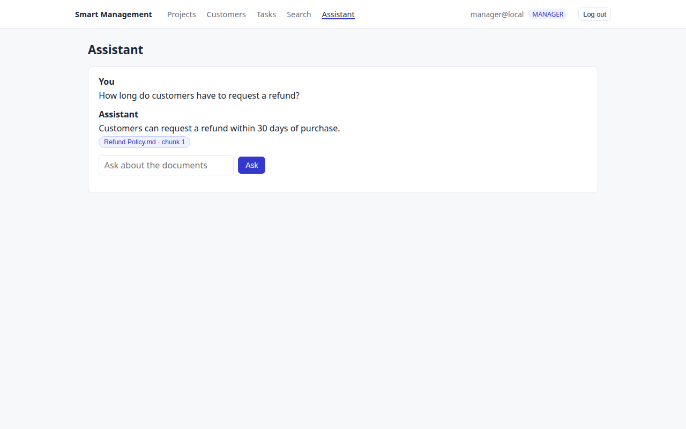
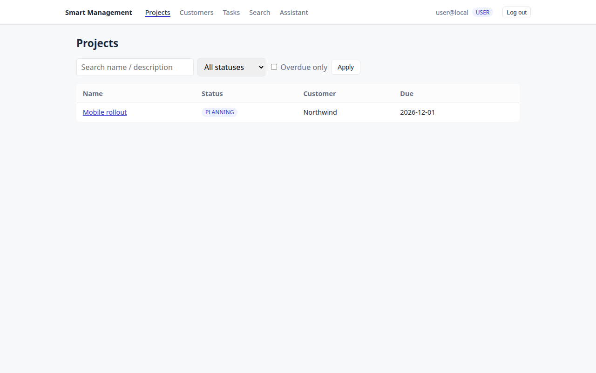

# Smart Management System

[](https://github.com/rouissimonir/smart-managment-system/actions/workflows/ci.yml)

A project workspace where the assistant answers from **this application's data**, not from a generic chat model.

Ask who owns a project and the API runs a fixed read-only tool. Ask what the refund policy says and it retrieves the passage, then cites the file. The model never receives a SQL string. With no `OPENAI_API_KEY` the same paths still run: keyword search is real, embeddings are a deterministic stand-in, and the assistant quotes the closest passage instead of inventing one.



## Architecture





| Layer | Choice |
|---|---|
| UI | Angular 20 |
| API | Spring Boot 4.1.1, Java 21, one JAR |
| Auth | JWT access token (15 min) and hashed rotating refresh token (7 days) |
| Data | PostgreSQL 16, pgvector, Flyway |
| Documents | Disk storage, Apache Tika, 600-token chunks, async ingest |
| Ops | Docker Compose demo profile, GitHub Actions |

## Quick start

```bash
export JWT_SECRET="$(openssl rand -base64 32)"
docker compose --profile demo up --build
```

- UI: http://localhost:8088
- API: http://localhost:8080
- Sign in with `manager@local` / `manager123`

The demo profile loads two customers, two projects, one assigned task, and the policy files under `backend/src/main/resources/demo/`. Ingestion finishes in the background. Leave `OPENAI_API_KEY` empty for the offline client, or set it for `text-embedding-3-small` and `gpt-4o-mini`.

`docker compose up -d db` starts only Postgres (host port **5433**). `./mvnw spring-boot:run` from `backend/` uses the `local` profile, which seeds data and still accepts the dev JWT secret. The `prod` profile, used by the demo container, refuses that default secret.

| Email | Password | Role |
|---|---|---|
| `admin@local` | `admin123` | ADMIN |
| `manager@local` | `manager123` | MANAGER |
| `user@local` | `user123` | USER |

These accounts are for the local demo. Replace them, and `JWT_SECRET`, before any shared deployment.

## What you can click through



A project shows its tasks, document status, chunk count, and an assistant scoped to that project.



Search returns the passage, the file name, and a locator. Keyword, semantic, and hybrid (reciprocal rank fusion, k = 60) are separate modes.



A grounded answer keeps a citation chip. "I don't know." drops the sources.



`user@local` sees Mobile rollout, the project they own, and does not get a New project button. Website revamp stays with the manager.

The shots above are the Angular UI against a stand-in API so the pages are filled. The same screens are what the Compose demo serves after seed and ingestion.

## RBAC

| | ADMIN | MANAGER | USER |
|---|---|---|---|
| Customers | full CRUD | full CRUD | read |
| Projects | full CRUD | full CRUD | own projects only |
| Tasks | full CRUD | full CRUD | assigned tasks; may update status, title, description, due date |
| Documents | all | all | owned projects only; no project-less upload |
| Reprocess | yes | yes | no |
| User directory | yes | yes | no |
| Audit log | yes | no | no |
| Search and chat | all visible documents | all visible documents | owned projects only |

Login is capped (10 attempts per minute per address, in memory). A refresh token that is presented again after rotation revokes every token in that family. `GET /actuator/health` and `GET /actuator/info` are public; other actuator paths require a token. Only health and info are exposed.

## Why tools, not free SQL

The router is a small set of rules, not a model call, so a data question does not spend an embedding or a chat completion.

| Intent | Example | What runs |
|---|---|---|
| `SQL_DATA` | Who owns Website revamp? | A Java method: project by name, overdue count, tasks for a project, or customers not updated since a date |
| `VECTOR_RAG` | What is the refund policy? | Embed the question, take the top 5 chunks the caller may see, answer from those excerpts |
| `HYBRID` | Compare the refund policy with Website revamp | Both, then one answer |
| `GENERAL` | What can you do? | A fixed help reply |

Each tool is a query written in the repository. The caller's role is applied inside that method: a USER does not learn that a hidden project exists. There is no path that concatenates the question into SQL, so the model cannot widen the query, and a prompt cannot become a statement.

## Evaluation

`eval/dataset.jsonl` has 10 questions. Nine name the file that should appear in the top 5 hits. One ("office wifi password") has no source and is not scored. `eval/score.py` logs in and calls `GET /api/search`.

Keyword search ORs the English lexemes, so one matching word is enough. `plainto_tsquery` ANDs them, and a question such as "how long do customers have to request a refund?" would miss because "long" is not in the file.

The cancellation question was written as a semantic check: the file is `Account Closure Terms.md` and the body says "subscription termination". On this seed it is also a keyword hit. That file contains "cancelled" (the same English stem as "cancellation") and the word "policy". With two short documents and k = 5, both modes place the expected file in the top 5 for every scored question. That is a corpus result. It is not an embedding score. The offline client sets `semanticMeaningful` to false. A semantic number needs `OPENAI_API_KEY` and a reprocess.

The demo CI job scores the seeded policies with the offline client, after the smoke upload has been deleted. Measured on [run 45596580957](https://github.com/rouissimonir/smart-managment-system/actions/runs/45596580957) (`95200d9`, 25 Nov 2026, 11:37 Africa/Tunis):

| Mode | Hit-rate@5 |
|---|---|
| KEYWORD | 9/9 (100%) |
| HYBRID | 9/9 (100%) |

An earlier run on the same seed, before lexemes were OR-ed and while the smoke-test upload was still indexed, scored keyword 5/9 and hybrid 9/9. The keyword misses were questions whose extra words are not in the files. Hybrid still listed every document inside k = 5.

```bash
python3 eval/score.py --self-test
python3 eval/score.py --base http://localhost:8080 --mode KEYWORD --k 5
python3 eval/score.py --base http://localhost:8080 --mode HYBRID --k 5
```

## Tests and CI

```bash
cd backend && ./mvnw test          # Testcontainers, Docker required
cd frontend && npx ng test --watch=false --browsers=ChromeHeadless
cd frontend && npx ng build --configuration=production
python3 scripts/demo-smoke.py      # stack already running
```

GitHub Actions runs the backend suite, the Angular test and production build, the scorer self-test, and a Compose job that boots the demo profile, signs in, waits for the seeded documents, searches, chats, uploads a note, and prints hit-rate.

## Limitations and roadmap

- Semantic order is meaningless until `OPENAI_API_KEY` is set. Keyword search and cited extractive answers work without it.
- Ingestion and the login limiter live in memory. A restart re-queues documents from the `UPLOADED` / stale `PROCESSING` rows, but a second instance would not share the queue or the limiter.
- The audit log records login, project create/update/delete, and document upload/delete. It is `GET /api/audit` for ADMIN. There is no audit screen.
- This repository does not deploy the stack to a public host. Compose is the demo.
- Redis, WebSockets, and the Grafana stack under `observability/` are not wired.

## API

| Resource | Endpoints |
|---|---|
| Auth | `POST /api/auth/login`, `refresh`, `logout`, `GET /api/me` |
| Customers, projects, tasks | CRUD, paged lists |
| Documents | `POST /api/documents`, `GET/DELETE /api/documents/{id}`, download, reprocess, `GET /api/projects/{id}/documents` |
| Users | `GET /api/users` (ADMIN, MANAGER) |
| Search | `GET /api/search?q=&mode=KEYWORD\|SEMANTIC\|HYBRID` |
| Chat | `POST /api/chat`, `GET /api/chat/conversations/{id}` |
| Audit | `GET /api/audit` (ADMIN) |

Everything except `/api/auth/**`, `/api/health`, `/actuator/health`, and `/actuator/info` requires a bearer token. Lists take `page`, `size` (max 100), and an allowlisted `sort`.
